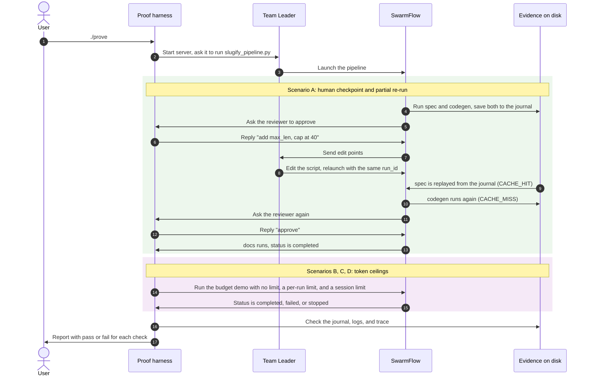

# Predictable AI workflows with JiuwenSwarm SwarmFlow: human checkpoints, partial re-runs, token ceilings

This repo backs a tutorial about **SwarmFlow**, the workflow engine in [JiuwenSwarm](https://pypi.org/project/workswarm/). It contains two things:

1. **Example SwarmFlow pipelines** (in `pipeline/`). One is a code-generation pipeline with a human review checkpoint. Two are small scripts that show SwarmFlow's two token ceilings.
2. **A proof harness** (in `harness/`). It runs those pipelines on a real JiuwenSwarm server with a real LLM. Then it checks what actually happened, using the server's own evidence: the run journal on disk, the engine's cache decisions, the `workflow.updated` events, and the exact diagnostic message the Team Leader got.

For verifying the tutorial's claims, you can simply run `./prove`, and it exits `0` only if every check passes in every repeat.

Verified with `workswarm==0.2.7` (JiuwenSwarm) and `openjiuwen==0.1.19` (Agent Core, the SwarmFlow engine). OpenAI `gpt-5.5` (`gpt-5.5-2026-04-23`) was the model for both the Team Leader and the workers. Tested on Linux (Ubuntu) with Python 3.12.

## Background: the pieces involved

| Term | What it is |
|---|---|
| **JiuwenSwarm** | A multi-agent app (PyPI package `workswarm`). In *Team mode* a **Team Leader** agent takes your chat messages and coordinates worker agents. |
| **SwarmFlow** | An optional engine (from `openjiuwen`) that the Leader starts with its `swarmflow(script_path=..., args=...)` tool. It runs a Python script whose `run()` function calls `agent(...)` (one worker LLM call) and `human(...)` (wait for a person's reply). The script fixes the order of steps, so a model doesn't decide them at run time. |
| **Run journal (WAL)** | SwarmFlow writes each finished `agent()`/`human()` call to a `wf_<run_id>.wal` file. The key is the call's position in the script plus a hash of its prompt (the "prompt signature"). If a run is resumed and a call's key matches, the engine replays the saved result (`CACHE_HIT`) and doesn't call the model again. |
| **Two token ceilings** | `META["workflow_token_limit"]` in a script caps **one run**. `swarmflow_budget`, sent with each chat message, caps the **whole session (team)**, including the Leader's own calls. |

## What the proof shows

Each repeat runs four scenarios, each in its own chat session:

| Scenario | What happens | What is checked |
|---|---|---|
| **A. Human checkpoint** (`slugify_pipeline.py`) | `spec` → `codegen` → `human()` review → `docs`. The reviewer asks for an edit ("add `max_len`, cap at 40"). | Before the edit, `docs` hasn't run. The generated `slugify` returns a slug of about 80 characters (the control). The edit request is classified `edit_rerun`, the run is `paused`, and the journal has an `early_return` pause record. |
| **A. Partial re-run** | SwarmFlow hands "Edit points" to the Team Leader. The Leader edits the script on disk by itself and relaunches with `resume_id=<run_id>`. | The diff is recorded and the `run_id` stays the same. `spec` is a `CACHE_HIT`, and its text is byte-identical. `codegen` runs again with a new prompt signature. The new code has `max_len`, and when executed it returns at most 40 characters. The checkpoint asks again, and `approve` lets `docs` run. The status is `completed`. |
| **B. Budget control** (`budget_demo_unlimited.py`) | `outline` → `draft` → `headline`, no per-run limit | `completed`, all 3 agents journaled |
| **C. Per-run ceiling** (`budget_demo.py`) | Same agents, `META["workflow_token_limit"] = 30000` | `failed`, `budget_exhausted_scope=workflow`, `headline` never runs. The Leader is told to redesign the script and relaunch with `resume_id`. |
| **D. Team ceiling** (`budget_demo_unlimited.py`) | Same script as B, with a small `swarmflow_budget` for the session: the Leader's pre-launch spend plus one worker call, both measured in B | `stopped`, `budget_exhausted_scope=session`, `headline` never runs. The Leader is told the ceiling must be raised (new session). |

A final check confirms the API key appears in no file under the JiuwenSwarm home, the temp dir or the proof output.

[PROOF.md](PROOF.md) has the full contract, including every check by ID and what the proof does *not* demonstrate.

## How it works



`./prove` creates `.venv` and installs the pinned packages from `requirements.txt`. Then, for every repeat, it:

1. creates a fresh JiuwenSwarm home in a temp dir with `jiuwenswarm-init` (your `~/.jiuwenswarm` is never touched) and applies the settings listed under [Setup choices](#setup-choices-and-why),
2. starts `jiuwenswarm-start app`, with the key only in the server's environment,
3. drives the Team Leader over the same WebSocket API the web UI uses,
4. runs scenarios A to D, checks everything, stops the server and deletes the home.

It exits 0 only if every check passes in every repeat.

**How the partial re-run works in scenario A.** The reviewer's reply is classified as `edit_rerun`. SwarmFlow pauses the run and gives the Leader "Edit points". The Leader changes one line on disk (`CODEGEN_RULES` in `slugify_pipeline.py`) and calls `swarmflow(..., resume_id=<run_id>)`. The `spec` prompt hasn't changed, so its signature matches the journal and the saved result is replayed. The `codegen` prompt now embeds the new rule, so its signature differs and it runs again. The `human()` prompt embeds the new code, so the reviewer is asked again. The harness itself never edits the script.

### Repository layout

| File | Role |
|---|---|
| `prove` | Entry point. Loads `OPENAI_API_KEY` and `MODEL_NAME` from the environment or `.env`, checks the Python version, creates `.venv`, installs `requirements.txt`, then runs the harness. |
| `harness/setup_home.py` | Builds the throwaway JiuwenSwarm home. It enables SwarmFlow, sets English, turns off the onboarding guide, and writes the OpenAI model settings **without** the key. |
| `harness/sfclient.py` | `Server` starts and stops the JiuwenSwarm process and waits for its ports. `Client` is a minimal WebSocket client that records every frame and lets the harness wait for a specific event. |
| `harness/run_proof.py` | The scenarios and checks. Its helpers merge `workflow.updated` deltas into one snapshot (`merged`), read WAL files (`wal_records`), grep the engine logs for `CACHE_HIT`/`CACHE_MISS` (`wf_log_lines`), find the budget message the Leader got (`guidance_text`), and run the model's `slugify` code in a subprocess (`exec_slugify`). |
| `pipeline/slugify_pipeline.py` | Scenario A: spec → codegen → human review → docs |
| `pipeline/budget_demo.py` | Scenario C: three agents with `workflow_token_limit = 30000` |
| `pipeline/budget_demo_unlimited.py` | Scenarios B and D: the same three agents, no per-run limit |
| `PROOF.md` | The demo contract: claim, scenarios, pass bar, and what isn't demonstrated |

Each pipeline script has a static `META` dict (read before anything runs, so it must be a pure literal) and an `async def run(args)`.

## Prerequisites

- Linux or macOS, Python 3.11 to 3.13
- An OpenAI API key with access to `gpt-5.5`. Each repeat uses roughly 1.4M tokens, mostly cached prompt reads (see [Cost](#cost)).
- Ports 19000, 19001 and 18092 free (JiuwenSwarm's web channel, gateway and agent server)

## Run it

```bash
cp .env.example .env        # put your key in OPENAI_API_KEY (no quotes, no spaces), or export it instead
./prove --repeat 3
```

One repeat takes about 7 minutes.

Optional settings:

| Variable | Effect |
|---|---|
| `MODEL_NAME` | Model for the Leader and the workers (default `gpt-5.5`, the one the proof was recorded with) |
| `PROOF_OUT` | Output directory (default `proof-out/`) |
| `KEEP_HOME=1` | Keep the temp JiuwenSwarm home after the run so you can inspect it |
| `PYTHON` | Interpreter used to create `.venv` (default `python3`) |

## Reading the output

`proof-out/` (or `$PROOF_OUT`):

- `report.json`: the summary across repeats (`all_passed`, the failed check IDs per repeat)
- `repeat-N/transcript.md`: **start here.** It has every message sent to the Leader, its `swarmflow` tool calls, the checkpoint questions and replies, and a run tree after each step (phases, per-agent status and tokens, both budget ledgers). It also has the engine's `CACHE_HIT`/`CACHE_MISS` lines, the run journal, the budget diagnostics, and a PASS/FAIL line per check.
- `repeat-N/report.json`: the checks for that repeat
- `repeat-N/events.jsonl`: every raw WebSocket frame received
- `repeat-N/slugify_pipeline.after-leader-edit.py`: the script as the Leader left it
- `repeat-N/wf_*.wal`: the SwarmFlow run journals. Each has one JSON line per finished call (with its prompt signature, tokens and result), plus pause and seal records.

## Setup choices, and why

| Setting | Value | Why |
|---|---|---|
| `modes.team.jiuwen_team.enable_swarmflow` | `true` | SwarmFlow is off by default. It runs only in Team mode, started by the Leader's `swarmflow` tool. |
| `swarmflow_budget` (sent with each `chat.send`, as the web UI does) | 3,000,000, or the measured value in scenario D | The team-wide (session) ceiling. It counts the Leader's own model calls as well as the workers', and it gates the Leader too. A budget smaller than one Leader call (about 43k tokens with gpt-5.5) stops the Leader before it can launch anything. |
| `META["workflow_token_limit"]` in `budget_demo.py` | 30,000 | The per-run ceiling. One worker call costs about 25k tokens with gpt-5.5, because every worker is a full agent with a large system prompt. `outline` + `draft` (~49k) cross 30k, so the run stops before `headline`. |
| `preferred_language` | `en` | `jiuwenswarm-init` keeps Chinese as the default when it can't prompt |
| `setup_guide.enabled` | `false` | The first-run onboarding guide distracts the Leader |
| `.env` model settings | `MODEL_PROVIDER=OpenAI`, `ENDPOINT_PROFILE=openai`, `API_BASE=https://api.openai.com/v1`, `MODEL_NAME=gpt-5.5` | The `API_KEY` line is removed. The key is passed only in the server's process environment, and the harness scans the home and the output for it. |
| Leader prompt (A) | `Run swarmflow(script_path='...', args='...').` | Naming the tool makes the Leader call it directly |
| Leader prompt (B-D) | The same, plus `Do not edit the script and do not relaunch it yourself.` | The budget guidance tells the Leader to redesign and relaunch. The proof needs to see the stopped run as it is. |
| Who applies the edit | The Team Leader, by itself | SwarmFlow answers an edit request with "Edit points" and tells the Leader to edit the on-disk script minimally and relaunch with `resume_id`. If the Leader only asks for confirmation, the harness confirms once and records it as a nudge. |
| Comment above `CODEGEN_RULES` | "The one line a reviewer's edit will change..." | It explains the journal to the reader. The Leader reads the script before editing, so the comment also steers where its edit lands. |
| Driving the server | WebSocket `ws://127.0.0.1:19000/ws` (`chat.send`, `chat.swarmflow_reply`) | The headless process SDK has no Team mode, so SwarmFlow can't run through it |

**Retries.** If the Leader doesn't call `swarmflow` with the requested script, the harness re-sends the request (up to 3 times) and records each retry in the transcript. A model-call error (quota, auth) fails the repeat immediately. Nothing else is retried.

## Things to know about SwarmFlow (found while building this)

- `workflow.updated` events are deltas. Each one carries only the phases that changed, so a monitor must merge them (see `merged()` in `harness/run_proof.py`).
- A human reply is classified as either `continue` or `edit_rerun`. There is no built-in "reject". Classification uses an extra model call, and formatting the reply uses another (about 24k tokens).
- The `human()` call is journaled too. After an edit, its prompt contains the new code, so its signature changes and the reviewer is asked again.
- The team ceiling (`swarmflow_budget`) counts the Leader's own model calls, and it stops the Leader as well as the workers.
- Hitting the per-run ceiling leaves a resumable run (`failed` plus a pause record). Hitting the team ceiling seals the run (`stopped`).
- The budget diagnostics go to the Leader as a follow-up message, not straight to the user. The Leader then explains them in its reply. The harness reads the exact text from `<home>/.jiuwenswarm/.trace/`.
- `jiuwenswarm-tui` isn't used here. On PyPI it stops at 0.2.4b3 (stable 0.2.3), while JiuwenSwarm is at 0.2.7. Every release ships only macOS arm64 and Windows wheels, so `pip install jiuwenswarm-tui` fails on Linux. The run trees in the transcript are built from the same `workflow.updated` events a UI consumes.
- Run control exists in the tool: `swarmflow(resume_id=<run_id>, action=...)` routes pause/resume/stop to the background-task controller. This repo doesn't exercise it.

## Cost

Each SwarmFlow worker is a full agent, so even a one-sentence `agent()` call costs about 25k tokens with `gpt-5.5`. Each Leader call costs about 43k, most of it a cached system prompt. In the recorded runs the four session ledgers added up to about 1.4M tokens per repeat (A ≈ 750k, B ≈ 290k, C ≈ 220k, D ≈ 110k).

---